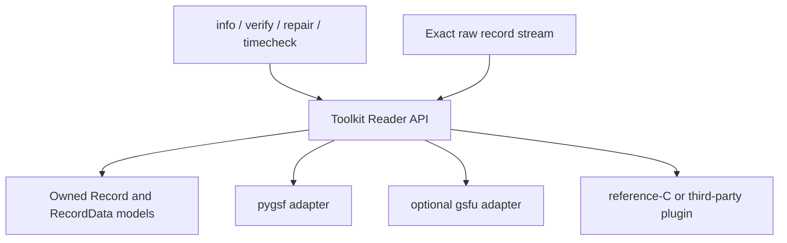

# Community GSF Toolkit - Developer Guide

This guide is for developers who want to understand, modify, or extend the Community GSF Toolkit.

## Project Structure

```
mb-community-toolkit/
├── tools/             # Command-line tools
│   ├── gsf_info.py
│   ├── gsf_verify.py
│   ├── gsf_repair.py
│   └── gsf_timecheck.py
├── profiles/          # JSON validation profiles
│   ├── xyz.json
│   ├── singlebeam.json
│   └── multibeam.json
├── docs/             # Documentation
├── data/             # Sample/test data files
└── requirements.txt  # Python dependencies
```

## Development Setup

### Prerequisites

- Python 3.7+
- pip
- Git

### Installation

1. Clone the repository:
   ```bash
   git clone https://github.com/your-org/community-gsf-toolkit.git
   cd community-gsf-toolkit
   ```

2. Install dependencies:
   ```bash
   pip install -r requirements.txt
   ```
   No git submodules are required; the reader implementation is bundled in `readers/base`.

3. (Optional) Install in development mode if creating a package structure

## Architecture Overview

### Core Components

- **Reader API**: Owns record framing, normalized data, selection, and adapter lifecycle
- **Parser Adapters**: Translate `pygsf`, optional `gsfu`, and installed plugins into that API
- **Profile System**: JSON-based validation profiles define required records and subrecords
- **Command Tools**: Standalone scripts for specific operations

### Key Dependencies

- `readers/base`: bundled implementation used only by the `pygsf` adapter
- `numpy`: Numerical operations for array processing
- `gsfu` and its pandas dependency: optional, installed with `pip install ".[gsfu]"`

### Configurable parser boundary



The toolkit owns `readers.model`, `readers.stream`, and `readers.backend`.
Tools import no parser library, library-specific enums, pandas tables, native
objects, or scale-factor dictionaries. Backend selection is explicit API/CLI
argument, then `MBTOOLKIT_GSF_BACKEND`, then `pygsf`. Imports and plugin loading
are lazy, and failures never cause automatic fallback.

```python
from readers import DecodeRequest, open_reader

with open_reader("survey.gsf", backend="gsfu") as reader:
    request = DecodeRequest(frozenset({2, 12}), beam_arrays=True)
    for record in reader.records(request):
        if record.record_id == 2:
            print(record.offset, record.data.fields["timestamp_ns"])
            depths = record.data.arrays.get(1)
```

`Record` carries the physical offset, complete record length, exact original
bytes, checksum status, backend provenance, and optional `RecordData`. Unknown
record IDs remain in file order as raw records. Metadata-only iteration does
not initialize a semantic decoder. A reader allows one active iterator; a new
pass starts fresh, and context exit closes partially consumed iterators.

Present checksums are verified by the common reader before semantic decoding,
so parser selection cannot silently change the checksum policy. Low-level
`iter_frames()` retains the checksum status for diagnostic inspection.

`RecordData.fields` uses profile snake_case keys. Distances are metres, angles
degrees, travel times seconds, speeds knots, amplitudes dB, and flags integers.
Absolute times use integer UTC epoch nanoseconds, including attitude samples.
`value("timestamp")` provides floating-point epoch seconds for existing profile
constraints and command output. Beam arrays are keyed by GSF subrecord ID.
Missing arrays are absent; present empty arrays stay distinct. The data models
copy beam and attitude arrays so native buffers cannot change past records.

Adapters own per-file scale-factor inheritance, naming and unit conversion,
unsupported-feature errors, and parser resource cleanup. Unsupported arrays
can be reported in `RecordData.diagnostics`; their presence is still observable
in the raw record. `BackendInfo` declares supported record types, beam arrays,
format major versions, parser version, and adapter API version.

API v1 defines shared semantic projections for file headers, bathymetry pings,
and attitude records, which cover the current commands' decoded data needs.
Other record types remain accessible as exact raw records. A library's broader
decoding support is not advertised until a normalized projection and conformance
tests exist; requests for unprojected types fail explicitly.

The `pygsf` adapter supports GSF 3.x semantic decoding and explicitly rejects
compressed arrays and packed quality flags. The `gsfu` adapter currently targets
the tested 0.5.x API and supports 2.x and 3.x. Its library-specific column names
and index table stay inside the adapter. Both use the same toolkit framing,
including checksum-header accounting and retention of unknown records.

`DecodeRequest` specifies the requested projection. A library may decode more
internally: gsfu 0.5.1 decodes beam payloads when reading ping headers and builds
an index of requested record types before the pass. Performance and rejection
of unsupported encodings can therefore differ; the toolkit reports these errors
instead of pretending another parser was used.

### Reference C and other plugins

Backend API **v1** is `readers.Decoder`: provide `info: BackendInfo`, optional
`begin(path, version, request)`, `decode(record, request) -> RecordData`, and an idempotent
`close()`. Register a zero-argument factory in the plugin package:

```toml
[project.entry-points."mbtoolkit.gsf_backends"]
gsflib = "mbtoolkit_gsflib:GsflibDecoder"
```

Factories must return a `Decoder` whose `BackendInfo.name` matches the entry-point
name and whose `api_version` is 1. Built-in names `pygsf` and `gsfu` are reserved.
Discovery reads entry-point metadata; only the selected plugin is loaded.

The reference-C binding is a follow-up plugin, not implemented in this change.
Until installed, selecting `gsflib` raises `BackendUnavailableError`; there is
no stub decoder or substitution with another library. Its implementation should:

1. Bind an explicitly selected gsflib installation through a small compiled
   shim built against the matching `gsf.h`, rather than duplicating its large
   native unions and ABI layouts in Python.
2. Own one file handle and inherited scale-factor state per reader pass. Serialize
   access or isolate it if the linked gsflib uses shared global state.
3. Copy decoded native buffers into `RecordData` before the next C read, and
   release handles and allocated records on normal exit, errors, and early stop.
4. Report the linked library version and actual capabilities. Raise
   `UnsupportedFeatureError` for unsupported requests and `BackendUnavailableError`
   for missing libraries; never silently downgrade checksum or compression behavior.
5. Pass the same wire-fixture conformance tests as the Python adapters, with
   differential tests for values, units, nanosecond times, flags, unknown records,
   checksummed records, interleaved files, buffer ownership, and cleanup.

### Keep parsing, validation, and writing separate

Profile presence checks use raw subrecord IDs consistently across parsers;
semantic field constraints use normalized data. An unsupported decoder feature
must not be reported as proof that a physically present subrecord is absent.

Repair policy remains toolkit-owned. Raw copying and edits preserve unrelated
records and update sizes/checksums independently of the selected parser. Selecting
`gsfu` does not adopt PR #5's change from repair to copy/report behavior. Neither
backend selection nor an empty placeholder can recover missing measurements.
General re-encoding needs a separate writer contract, capability checks, and
round-trip tests; it is intentionally not implied by the read-only `Decoder` API.

Run backend tests in both a core-only environment and one with the `gsfu` extra.
Fixtures are encoded independently of both libraries so a parser cannot validate
its own encoding mistake. Contract tests also exercise an entry-point plugin
without requiring a C compiler or a native gsflib installation.

## Code Organization

### Scripts (`tools/`)

Each script is a standalone command-line tool:
- `gsf_info.py`: File inspection and information extraction
- `gsf_verify.py`: Profile-based validation
- `gsf_repair.py`: File repair and compliance fixing
- `gsf_timecheck.py`: Time ordering verification

### Profiles (`profiles/`)

JSON files defining validation rules:
- Record types and IDs
- Required header fields
- Required subrecords
- Constraints and encoding recommendations

## Extending the Toolkit

### Adding a New Tool

1. Create a new script in `tools/`
2. Follow existing patterns for:
   - Argument parsing
   - File I/O
   - Error handling
3. Add documentation
4. Update this guide

### Creating a New Profile

1. Create JSON file in `profiles/`
2. Define required records and subrecords
3. Specify constraints and encoding recommendations
4. Test with `gsf_verify.py`

### Common Patterns

**Reading GSF Files:**
```python
from readers.base import GSFREADER, SWATH_BATHYMETRY

reader = GSFREADER("file.gsf")
while reader.moreData():
    nbytes, recid, dg = reader.readDatagram()
    # Process datagram
```

**Profile Loading:**
```python
import json

with open("profile.json", 'r') as f:
    profile = json.load(f)['profile']
```

## Testing

### Running Tests

Install test dependencies:
```bash
pip install -e ".[dev]"
```

Run all tests:
```bash
pytest
```

Run specific test file:
```bash
pytest tests/test_utils.py
```

Run with verbose output:
```bash
pytest -v
```

### Test Structure

The `tests/` directory contains:
- `test_utils.py` - Tests for utility functions
- `test_gsf_verify.py` - Tests for profile loading and validation
- `test_gsf_repair.py` - Tests for repair functionality
- `conftest.py` - Shared pytest fixtures

### Writing Tests

1. Create test files following the pattern `test_*.py`
2. Use pytest fixtures from `conftest.py` when available
3. Follow existing test structure and naming conventions
4. See `tests/README.md` for more details

### Manual Testing

Test with sample GSF files in `data/` directory:
```bash
python tools/gsf_verify.py profiles/xyz.json data/sample.gsf
```

### Test Files

- Use provided sample files
- Ensure no sensitive data in test files
- Add new test cases as needed

## Code Style

- Follow PEP 8
- Use type hints where appropriate
- Add docstrings to functions
- Keep functions focused and modular

## Building and Distribution

(To be documented when package structure is established)

## Debugging

### Common Issues

- **Import errors**: Run tools from the repository root so `readers/base` is importable
- **File format errors**: Verify GSF file integrity
- **Profile validation**: Check JSON syntax and structure

### Debug Tips

- Use `--pingHeaderVerbose` in `gsf_info.py` for detailed inspection
- Check raw file structure with hex dump if needed
- Validate profile JSON syntax separately

## Contributing

See [CONTRIBUTING.md](../CONTRIBUTING.md) for contribution guidelines.

## Resources

- GSF Format Specification (to be linked)
- pygsf Documentation (to be linked)
- Community Resources (to be established)

---

**Note**: This is an initial placeholder. Detailed developer documentation including API references, architecture diagrams, and advanced topics will be added as the project evolves.

